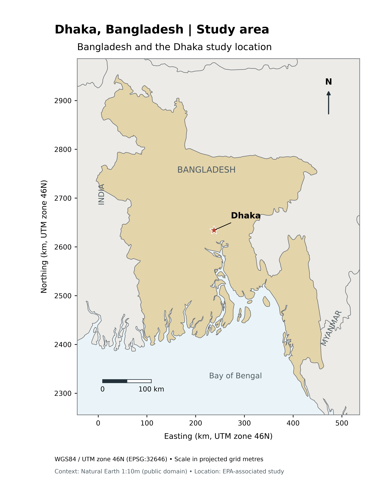
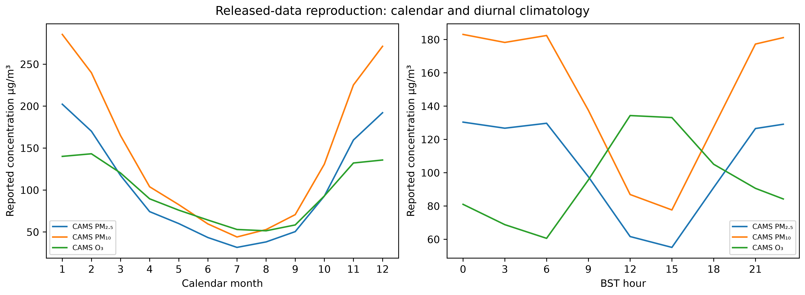
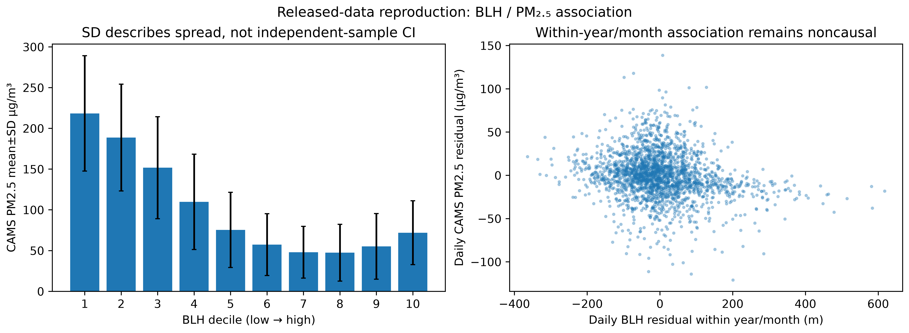
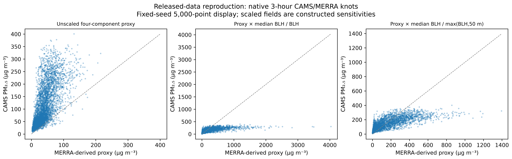
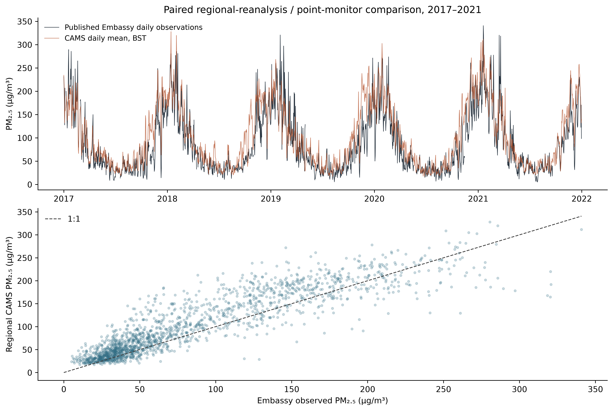

# Seasonal Air Pollution, Weather and Atmospheric Conditions in Dhaka, Bangladesh

## 1. Introduction and objectives

This study examines seasonal air pollution in Dhaka, its weather relationships and prediction. PM₂.₅ refers to particles with a diameter of 2.5 µm or less. Weather and pollution share seasonal patterns, so raw correlations can be misleading.

The objectives are to:

1. Describe observed PM₂.₅, seasonal patterns and high-pollution periods.
2. Assess trends with missingness and uncertainty considered.
3. Test whether weather improves simple predictions based on past pollution and the time of year.
4. Compare regional atmospheric estimates with monitored PM₂.₅.

## 2. Study area and data

### 2.1 Dhaka and the observed record

The **2016–2021** embassy PM₂.₅ observations come from observed columns in EPA-hosted research data [1]. Missing dates remain missing. Full hourly quality records and exact daily averaging rules were not recovered.

NASA POWER supplied complete temperature, dewpoint, humidity, wind, rainfall and pressure estimates for **2,192 UTC days** at **23.796374° N, 90.424614° E** [2]. These model estimates are separate from pollution observations.

The Natural Earth map [8] locates the embassy in Bangladesh; it defines neither a city boundary nor a pollution surface. [SVG](figures/study_area.svg) · [Figure PDF](figures/study_area.pdf).

### 2.2 Regional air-quality and weather data

Regional data came from **Barua and coauthors’ HyAQMet** release [5,7]. Its three public source CSVs match the linked version byte for byte. The products combine models with observations; they are not direct MODIS or Sentinel measurements.

| Product | Provider | Stated grid | Original time interval | Main fields |
|---|---|---|---|---|
| ERA5-Land | ECMWF / Copernicus | 0.1° | Hourly | Nine weather fields, including derived humidity and wind |
| ERA5 Single Levels | ECMWF / Copernicus | 0.25° | Hourly | Boundary-layer height and cloud cover |
| CAMS EAC4 | ECMWF / Copernicus | 0.75° | Three-hourly | Six pollutants and dust aerosol optical depth |
| MERRA-2 | NASA GES DISC | 0.5° × 0.625° | Hourly | 26 candidate fields; 13 retained fields |

The **2017–2022** data have **52,584 hourly rows and 42 fields**, including dates and calculated features. Estimating between **17,528 original CAMS records** adds hourly labels, not independent observations. The source values were already selected and averaged for the study area. Original gridded NetCDF downloads and conversions were not repeated; the exact MERRA-2 grid point cannot be recovered from the CSVs.

## 3. Methods

### 3.1 Seasonal patterns, high-pollution days and trend

Means use observed days and report coverage. Calendar months are primary; seasonal groups are December–February, March–May, June–September and October–November. Both HyAQMet six-season calendars are checked separately.

The WHO 2021 daily value of **15 µg/m³** is used as a benchmark for earlier observations [4]. High-pollution runs are consecutive observed days above the whole-record 95th percentile. Missing days interrupt a run.

Trend analysis requires **75% monthly coverage**. Calendar-month medians are removed. **Theil–Sen** estimates trend from the median of slopes between month pairs. Uncertainty uses **1,000 resampling repeats** of 12-month groups, with six-month groups as a check. These block-bootstrap intervals assume stable remaining variation and hold the seasonal estimate fixed.

### 3.2 Weather relationships and prediction

Pearson/Spearman correlations compare weather and pollution before/after calendar adjustment. All −1/0/+1-day weather shifts are reported, without selecting a favorable shift.

**Ridge regression** limits unstable linear-model coefficients, using fixed penalty **α = 1**. Inputs are PM₂.₅ lags 1/7/365 and annual sine/cosine terms. The extension adds temperature, humidity, wind, rain and pressure from **two UTC days earlier**. This reduces previous-UTC-day overlap with a local target day; release delays remain unknown.

Training starts in **2016–2017**, with monthly expanding fits during 2018–2021. Missing inputs use training medians, and inputs are scaled using training data only. Targets are never filled. Daily observed lags update. Both periods are historical evaluations, not prospective tests.

Models are compared on the same observed days. Extra weather benefit is checked with **1,000 paired resampling repeats**, using seven- and 30-day groups.

### 3.3 Regional and observed comparisons

Regional calculations cover monthly/hourly patterns, product comparisons and atmospheric mixing. Values remain unchanged. Boundary-layer height (BLH) is the depth of the lower mixing layer. Variance inflation factor (VIF) measures predictor overlap.

The **2017–2021** CAMS–embassy comparison checks Bangladesh and UTC calendar days, including shifts of one day earlier or later. Monthly means use the same paired days with at least 75% coverage. Resampling groups of seven or 30 days gives uncertainty intervals for those matched records; it does not account for every possible data error.

An AirNow mirror [3] matches **523/530 daily means** within 0.0001 µg/m³ under local labels. This supports partial-period timing, not another independent station or full-record quality certification.

## 4. Results

### 4.1 Data coverage and concentration levels

| Year | Observed / calendar days | Coverage | Mean PM₂.₅, µg/m³ |
|---|---:|---:|---:|
| 2016 | 365 / 366 | 99.73% | 86.40 |
| 2017 | 352 / 365 | 96.44% | 79.72 |
| 2018 | 344 / 365 | 94.25% | 88.29 |
| 2019 | 359 / 365 | 98.36% | 86.31 |
| 2020 | 352 / 366 | 96.17% | 84.63 |
| 2021 | 345 / 365 | 94.52% | 98.02 |
| **All years** | **2,117 / 2,192** | **96.58%** | **87.18** |

The overall mean is **87.18**, median **60.71** and maximum daily concentration **340.79 µg/m³**. High-concentration days raise the mean above the median. These summarize one location’s available days. [Annual table](results/annual_pm25.csv) · [Summary](results/observed_summary.json).

The lower panel shows changing monthly coverage. The 75 missing days remain unknown.

### 4.2 Monthly and seasonal patterns

| Seasonal window | Observed / calendar days | Mean PM₂.₅, µg/m³ |
|---|---:|---:|
| Winter, December–February | 527 / 542 | **172.02** |
| Pre-monsoon, March–May | 525 / 552 | 76.40 |
| Monsoon, June–September | 711 / 732 | **33.53** |
| Post-monsoon, October–November | 354 / 366 | 84.61 |

January has the highest monthly mean (**193.29 µg/m³**) and July the lowest (**30.16**). The winter mean is **5.13 times** the monsoon mean. The seasons have different lengths, so their coverage is reported separately. The figure also compares available-day means with means giving each eligible year equal weight. [Monthly](results/monthly_pm25.csv) · [Seasonal](results/seasonal_pm25.csv) · [Paper-date six seasons](results/six_season_sensitivity.csv) · [Alternative six seasons](results/six_season_release_sensitivity.csv).

### 4.3 High-pollution days

| Indicator | Result |
|---|---:|
| Observed days above 15 µg/m³ | **2,068 / 2,117 (97.69%)** |
| Whole-record 95th percentile | **212.77 µg/m³** |
| Observed runs above that percentile | **56** |
| Longest uninterrupted observed run | **6 days** |

Most observed days exceed the retrospective WHO daily benchmark. This does not measure legal compliance, personal exposure or health outcomes. The six-day run is the longest recorded without a gap; missing days could hide longer episodes. The threshold describes this record and was not chosen as a future warning rule. [Episodes](results/episodes.csv).

### 4.4 Short-period trend

**69 of 72 months** pass the coverage screen. April 2018, May 2020 and September 2021 are excluded.

| Season-adjusted estimate | µg/m³/year |
|---|---:|
| Theil–Sen slope | **+0.677** |
| 12-month block 95% interval | **−0.166 to +1.533** |
| Six-month check | **−0.588 to +2.027** |

Both intervals include zero. The study therefore does **not establish an increasing trend**. It also does not prove no change or identify a climate-change effect. [Trend results](results/trend.csv).

### 4.5 Weather relationships

| Weather variable | Raw Pearson r | After calendar-month adjustment |
|---|---:|---:|
| Temperature | −0.755 | −0.077 |
| Relative humidity | −0.616 | −0.328 |
| Wind speed | −0.464 | −0.260 |
| Rainfall | −0.440 | −0.184 |
| Pressure | +0.736 | +0.068 |

Temperature and pressure relationships become much weaker after accounting for the seasonal calendar. Their raw correlations largely share that seasonal pattern. The remaining relationships do not establish causes.

Maximum weather VIF falls from **267.72 to 4.49** when dewpoint is omitted. Dewpoint is closely related to temperature and humidity, so the prediction model keeps the other five weather fields. This reduces overlap without proving that these are the best possible predictors. [Correlations](results/weather_correlations.csv) · [VIF](results/weather_vif.csv).

### 4.6 Prediction performance

**2020–2021 comparison on the same 670 observed days**

MAE is average absolute error. RMSE gives larger errors more weight; lower values are better. R² compares predictions with a constant-mean reference.

| Model | MAE, µg/m³ | RMSE, µg/m³ | R² |
|---|---:|---:|---:|
| Previous-day persistence | 19.90 | 29.51 | 0.815 |
| Calendar-month average | 25.56 | 37.00 | 0.709 |
| 365-day seasonal baseline | 34.10 | 49.26 | 0.484 |
| Ridge: past PM₂.₅ + calendar | 18.84 | **27.74** | 0.836 |
| Ridge + lag-two weather | **18.77** | **27.48** | 0.839 |

Past PM₂.₅ and calendar patterns improve on persistence in this comparison. Weather adds only a small later-period improvement.

| Period | Paired core/weather days | Weather minus core RMSE | 30-day block 95% interval |
|---|---:|---:|---:|
| 2018–2019 | 703 | **−1.274 µg/m³** | **−1.847 to −0.278** |
| 2020–2021 | 697 | **−0.325 µg/m³** | **−0.810 to +0.382** |

Negative differences favor weather. The earlier interval supports an improvement under these assumptions; the later interval includes zero. Later-period extra weather benefit is **not established**, and its MAE interval also spans zero. These paired samples differ from the 670 all-model days. [Scores](results/models.csv) · [Paired intervals](results/weather_increment.csv).

### 4.7 Regional air quality and atmospheric mixing

CAMS mean PM₂.₅ is **102.333 µg/m³**, matching the paper's rounded 102.3 [5]. The 52,584-row, 42-field structure and 26-to-13 MERRA field counts also match the shared data.

These curves describe regional model estimates. They show monthly and daily patterns, but interpolated hours are not new independent measurements. [Monthly patterns](results/reference/release/pollutant_calendar_month_climatology.csv) · [Hourly patterns](results/reference/release/pollutant_local_hour_climatology.csv) · [Paper comparison](results/reference/release/paper_vs_reproduced.csv).

The lowest/highest BLH-decile PM₂.₅ contrast is **3.036×**. Direct hourly correlation is **−0.4904**, compared with **−0.65** in the paper. Daily correlation is **−0.5069**, weakening to **−0.2020** after removing within-year/month patterns. The difference from the printed value remains unresolved. These relationships do not isolate the causal effect of atmospheric mixing. [BLH results](results/reference/release/blh_associations.csv).

The four-component MERRA sum averages **37.402 µg/m³**, compared with CAMS **102.333**. The component sum is not a complete measured PM₂.₅ total. BLH-scaled versions, with and without a 50 m floor, are constructed sensitivity checks rather than validated corrections. [PM comparisons](results/reference/release/pm25_intercomparison.csv) · [Three-hour check](results/reference/release/pm25_native_3hour_sensitivity.csv) · [Weather/SO₂ comparisons](results/reference/release/meteorology_and_so2_intercomparison.csv).

### 4.8 Comparison with observations

| Nominal Bangladesh-day comparison, 2017–2021 | Result |
|---|---:|
| Paired days | **1,752** |
| Pearson r | **0.897** |
| Bias: CAMS minus observation | **+16.15 µg/m³** |
| MAE | **24.98 µg/m³** |
| RMSE | **34.23 µg/m³** |
| 30-day block 95% bias interval | **+11.74 to +20.75 µg/m³** |

CAMS follows much observed variation while reporting higher concentrations on average. On **57 eligible months**, using identical paired days, r is **0.955** and RMSE **24.59 µg/m³**. A regional area and a point monitor represent different places and scales. [Metrics](results/reference/observed_comparison/reference_metrics.csv) · [Date checks](results/reference/observed_comparison/daily_alignment_sensitivity.csv) · [Intervals](results/reference/observed_comparison/block_uncertainty.json).

### 4.9 Data quality

Retained MERRA fields have maximum VIF **25.27** with centered data and **95.87** without centering. This difference shows that calculation choices matter. Neither value proves an optimal field selection or absence of overlap.

Paper and release season labels differ at **13,968 hours**. Both calendars remain separate sensitivity analyses; calendar months stay primary.

The rainfall field sums to **20,142–33,893 mm/year if treated as hourly water amounts**. These are diagnostic sums, not verified rainfall totals. The original accumulation intervals and reset rules are needed before correction. This suspect field was **not used** in the NASA-weather prediction experiment. [Rainfall check](results/reference/release/annual_precipitation_diagnostic.csv) · [Source and quality record](results/reference/release/quality_and_provenance.json).

Map and regional figures have [600 dpi PNG, SVG and figure-PDF versions](figures/reference). [Reproduction instructions](REPRODUCE.md) and the [export/source record](results/reference/export_manifest.json) describe the calculations.

## 5. Discussion and limitations

The strongest finding is the large seasonal contrast at the monitored location. Trend and added weather skill are less certain. High regional-product correlation should be read alongside concentration error and spatial differences.

Daily quality rules and full-record averaging details remain incomplete. Coverage thresholds do not remove bias from non-random missing days. UTC weather timing and provider delays limit operational interpretation. The prediction periods are retrospective, and block intervals do not cover every measurement or model uncertainty.

The earlier archive [6] changes numerically on **4 August 2022** and has unresolved measurement history, units and timezone. It cannot extend this study into a verified 26-year monitoring record. [Data selection](DATA_SELECTION.md).

Original regional extraction was not repeated. Rainfall and season definitions remain unresolved. The study does not estimate causal emissions effects, personal exposure, health outcomes, emission sources or climate-change attribution.

## 6. Further research

Priorities are station quality/timing, native rainfall metadata, additional monitors and longer consistent records. Choose a future test period before model selection. New models should beat temporal baselines on identical cases, with uncertainty across years and high-pollution periods. Earlier acquisition code could support a separately checked extension.

## 7. Conclusion

Observed Dhaka PM₂.₅ is strongly seasonal, with winter means about five times the monsoon mean. The short-period trend remains uncertain. Past pollution and calendar patterns provide useful predictions, while extra conservative-lag weather benefit is not established in the later period. Regional estimates follow much observed variation but have positive concentration bias. These findings support clear, limited conclusions from the available data.

## 8. References

1. **Sarwar, Golam / U.S. EPA.** *Characterizing variations in ambient PM₂.₅ concentrations at the U.S. Embassy in Dhaka, Bangladesh using observations and the CMAQ modeling system*. Research data. [doi:10.23719/1528454](https://doi.org/10.23719/1528454).
2. **NASA POWER.** Daily meteorological data and API documentation. [Official portal](https://power.larc.nasa.gov/).
3. **Rynazal, Ryza.** *Hourly PM₂.₅ concentrations for 12 cities*, secondary AirNow DOS archive, V2. Figshare, CC BY 4.0. [doi:10.6084/m9.figshare.12687695.v2](https://doi.org/10.6084/m9.figshare.12687695.v2).
4. **World Health Organization (2021).** *WHO global air quality guidelines*. [Official guidelines](https://www.who.int/publications/i/item/9789240034228).
5. **Barua, A.; Basak Shuvo, M.; Ali, S.; Khan, A. U.; Saad, A. M.** *HyAQMet: Hourly Air Quality and Meteorology Dataset for Dhaka*. Geoscience Data Journal. [doi:10.1002/gdj3.70111](https://doi.org/10.1002/gdj3.70111).
6. **Paul, Tapon (2026).** *Bangladesh Air Quality Index (AQI) Dataset (2000–2025): Historical Hourly Air Pollution Data Across 103 Cities*. Mendeley Data, V2. Source of the excluded earlier archive. [doi:10.17632/9j447cynb9.2](https://doi.org/10.17632/9j447cynb9.2).
7. **Barua, Adity; Basak Shuvo, Mrinal.** *Hybrid Atmospheric & Air Quality Meteorology Dataset for Dhaka*. Zenodo, CC BY 4.0. [doi:10.5281/zenodo.20705735](https://doi.org/10.5281/zenodo.20705735). [Source files at the inspected version](https://github.com/AdityBarua10/HyAQMet/tree/f23ee72d6bbec8a8ab36423295e14f1b8e3d4100).
8. **Natural Earth.** Public-domain 1:10m country context. [Terms](https://www.naturalearthdata.com/about/terms-of-use/) · [Map-source record](data/maps/context_manifest.json).
