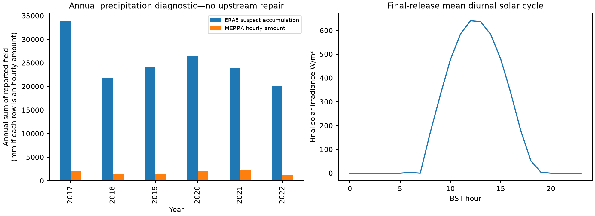

# Seasonal PM₂.₅ Variability, Meteorological Associations and Regional Reanalysis Agreement in Dhaka, Bangladesh

**Bipul Roy**

Research manuscript · Exploratory analysis · Not peer reviewed

[Download the manuscript PDF](paper.pdf) · [Reproduce the analysis](REPRODUCE.md)

## Abstract

This study examines observed particulate pollution, meteorological associations and regional reanalysis agreement in Dhaka. An EPA-hosted embassy record provides 2,117 daily PM₂.₅ values during 2016–2021, covering 96.58% of calendar days. Available-day winter and monsoon means were 172.02 and 33.53 µg/m³. A season-adjusted trend estimate of +0.677 µg/m³/year had a 12-month block-bootstrap interval spanning zero. On 670 common retrospective prediction days, persistence, calendar/lag Ridge and Ridge with conservative lag-two weather produced RMSEs of 29.51, 27.74 and 27.48 µg/m³. Incremental weather benefit remained uncertain. HyAQMet CAMS PM₂.₅ correlated strongly with 1,752 paired daily observations (r = 0.897), with positive bias of 16.15 µg/m³. Results demonstrate strong seasonality alongside uncertainties in trend, forecast availability, spatial representativeness and released-data processing.

## 1. Introduction and objectives

Dhaka experiences large seasonal variation in particulate pollution. A useful assessment needs to distinguish observed variation, meteorological associations, predictive information and agreement between regional products and a monitored location. Shared seasonality can produce strong correlations, while a model may track variation and still differ systematically in concentration.

Objectives:

1. Quantify observed PM₂.₅ coverage, seasonal variation and short-period trend uncertainty.
2. Examine weather associations after calendar adjustment and evaluate conservative retrospective prediction against temporal baselines.
3. Compare HyAQMet regional CAMS PM₂.₅ with published embassy observations and reproduce selected release-quality diagnostics.

## 2. Data and methods

### 2.1 Data and temporal support

Observed concentrations were extracted from the observed columns of EPA-hosted figure-support data for the U.S. Embassy in Dhaka, covering 2016–2021 [1]. Missing dates were retained. The source contains published daily values; full hourly QA logs and the exact full-record averaging rule were not recovered.

NASA POWER supplied UTC daily temperature, dewpoint, relative humidity, wind, precipitation and pressure at the embassy coordinates for the same period [2]. The final HyAQMet release covers 2017–2022 with 52,584 hourly rows and 42 fields [3,4]. Its CAMS pollutants are natively three-hourly before interpolation; regional footprints differ from the point monitor.

### 2.2 Descriptive and statistical analysis

Available-day statistics report explicit denominators. Calendar months are the primary climatology; seasonal windows are December–February (DJF), March–May (MAM), June–September (JJAS) and October–November (ON). Both conflicting six-season definitions in the HyAQMet paper and release are retained as sensitivity analyses. The WHO 2021 daily value of 15 µg/m³ was used as a retrospective benchmark [6].

Monthly trend inputs required at least 75% of calendar days. Calendar-month medians were subtracted before Theil–Sen estimation. Uncertainty used 1,000 residual moving-block replicates with 12-month blocks and a six-month sensitivity, conditional on the estimated seasonal profile and approximately stationary residuals.

Pearson/Spearman weather associations were examined with calendar-month and year/month adjustments. Daily date offsets of −1/0/+1 were retained as sensitivity checks. These screens are exploratory associations.

### 2.3 Prediction and reference comparison

Ridge regression, a regularized linear model with fixed penalty α = 1, used PM₂.₅ lags 1/7/365, annual sine/cosine terms and training-fold median imputation/scaling. Initial training covered 2016–2017, followed by monthly expanding refits and daily observed-lag updates. The weather extension used two-day-lagged UTC temperature, humidity, wind, rainfall and pressure. This avoids previous-UTC-day overlap with a local target day; actual publication latency remains unverified.

Model comparisons used identical observed dates. Weather-increment intervals used paired seven-/30-day calendar blocks. The historical dates were inspected retrospectively. HyAQMet was compared on daily BST and UTC bases with ±1-day sensitivity. A secondary hourly AirNow archive [5] informed daily-label interpretation without serving as another independent station.

## 3. Results

### 3.1 Observed coverage and seasonality

| Year | Observed / calendar days | Coverage | Mean PM₂.₅, µg/m³ |
|---|---:|---:|---:|
| 2016 | 365 / 366 | 99.73% | 86.40 |
| 2017 | 352 / 365 | 96.44% | 79.72 |
| 2018 | 344 / 365 | 94.25% | 88.29 |
| 2019 | 359 / 365 | 98.36% | 86.31 |
| 2020 | 352 / 366 | 96.17% | 84.63 |
| 2021 | 345 / 365 | 94.52% | 98.02 |
| **All years** | **2,117 / 2,192** | **96.58%** | **87.18** |

These available-day means represent one location; changing coverage may affect comparisons. [Annual table](results/annual_pm25.csv).

| Seasonal window | Observed days | Mean PM₂.₅, µg/m³ |
|---|---:|---:|
| Winter, DJF | 527 | **172.02** |
| Pre-monsoon, MAM | 525 | 76.40 |
| Monsoon, JJAS | 711 | **33.53** |
| Post-monsoon, ON | 354 | 84.61 |

The winter mean was **5.13 times** the monsoon mean. The unequal 3/3/4/2-month windows require separate coverage denominators. The figure also compares available-day and equal-year monthly weighting. [Monthly](results/monthly_pm25.csv) and [seasonal](results/seasonal_pm25.csv) tables provide the underlying values.

Of observed days, **2,068 (97.69%)** exceeded 15 µg/m³. This comparison does not estimate regulatory compliance, individual exposure or health outcomes; missing-day exceedances remain unknown.

### 3.2 Short-period trend remains uncertain

Sixty-nine of 72 months met the coverage screen. April 2018, May 2020 and September 2021 were excluded.

| Season-adjusted estimate | Result, µg/m³/year |
|---|---:|
| Theil–Sen slope | +0.677 |
| 12-month block 95% interval | **−0.166 to +1.533** |
| Six-month sensitivity interval | **−0.588 to +2.027** |

Both intervals span zero, so this analysis does **not establish an increasing trend**. Neither absence of change nor climate-change attribution is established. [Trend results](results/trend.csv).

### 3.3 Weather associations and retrospective prediction

| Weather variable | Raw Pearson r | Calendar-month-adjusted r |
|---|---:|---:|
| Temperature | −0.755 | −0.077 |
| Relative humidity | −0.616 | −0.328 |
| Wind speed | −0.464 | −0.260 |
| Rainfall | −0.440 | −0.184 |
| Pressure | +0.736 | +0.068 |

Temperature and pressure associations attenuate substantially after calendar adjustment, showing how shared seasonality influences raw correlations. Remaining associations remain descriptive. [Correlation results](results/weather_correlations.csv).

**2020–2021 common-case retrospective prediction: 670 days**

MAE is mean absolute error; RMSE is root mean squared error and weights large errors more heavily. Lower values indicate better predictions.

| Model | MAE, µg/m³ | RMSE, µg/m³ | R² |
|---|---:|---:|---:|
| Previous-day persistence | 19.90 | 29.51 | 0.815 |
| Calendar climatology | 25.56 | 37.00 | 0.709 |
| 365-day seasonal baseline | 34.10 | 49.26 | 0.484 |
| Ridge: PM₂.₅ lags + calendar | 18.84 | **27.74** | 0.836 |
| Ridge + lag-two weather | **18.77** | **27.48** | 0.839 |

Calendar/lag Ridge improved on persistence in this inspected comparison. Added weather made a small difference. On **697 paired core/weather days**, weather-minus-core RMSE was **−0.325 µg/m³**, with a 30-day block interval of **[−0.810, +0.382]**; the MAE interval also spans zero. These paired cases differ from the all-model intersection. Thus later-period incremental weather benefit is **not established**. [Model metrics](results/models.csv) and [paired uncertainty](results/weather_increment.csv).

### 3.4 Regional-product agreement with observations

| Nominal BST-day comparison, 2017–2021 | Result |
|---|---:|
| Paired days | **1,752** |
| Pearson r | **0.897** |
| Bias, CAMS minus reference | **+16.15 µg/m³** |
| MAE | 24.98 µg/m³ |
| RMSE | **34.23 µg/m³** |

Strong correlation coexists with positive concentration bias and differing spatial support. Monthly comparison on identical available days yields 57 eligible months, r = 0.955 and RMSE = 24.59 µg/m³. Alignment sensitivities remain explicit. A partial-period hourly mirror reproduced 523 of 530 daily means closely under local labels, supporting that convention without certifying full-record QA. [Reference metrics](results/reference_metrics.csv) and [alignment sensitivities](results/reference_alignment.csv).

### 3.5 HyAQMet release reproduction

| Check | Reproduced result |
|---|---|
| Structure | 52,584 rows × 42 fields; no expected-hour gaps |
| Season definitions | Paper/release labels disagree at **13,968 hours**; both retained separately |
| Boundary-layer height (BLH)–CAMS PM₂.₅ Pearson r | **−0.4904**, versus −0.65 printed in the paper |
| Lowest/highest BLH-decile PM contrast | **3.036×** |
| Released precipitation | Summed as hourly amounts: **20,142–33,893 mm/year**, indicating suspect accumulation semantics |
| Retained MERRA maximum centered variance inflation factor (VIF) | **25.27**, reduced from about 430,024 across 26 candidates |

The threefold BLH contrast is reproduced, while the printed correlation is not reproduced by the direct released-column calculation. Precipitation remains unchanged and flagged; no corrected total is certified. These suspect HyAQMet precipitation values were not used in the NASA-weather prediction experiment. VIF measures redundancy between predictors; its reduction does not establish optimal variable selection or absence of collinearity. MERRA component sums and BLH-scaled variants remain constructed proxies. [Quality checks](results/quality_checks.json), [precipitation](results/precipitation_diagnostics.csv), [season comparison](results/season_definition_comparison.csv), [paper-season sensitivity](results/seasonal_paper_definition.csv), [release-season sensitivity](results/seasonal_release_definition.csv) and [VIF results](results/merra_vif_retained.csv).

## 4. Discussion and limitations

The clearest finding is the observed seasonal contrast. Trend and incremental weather-skill claims are less secure. High regional-product correlation should be considered alongside concentration error, season-specific differences and spatial support.

The embassy series represents one location, with incompletely recovered daily QA and averaging rules. NASA days are UTC; lag-two weather reduces overlap risk but does not demonstrate operational release availability. Model evaluation is retrospective, with conditional block intervals and limited years. Reanalysis interpolation does not add independent measurements. The precipitation concern requires native accumulation metadata; conflicting six-season definitions remain separate sensitivities. No causal emissions, health-outcome, personal-exposure or source-apportionment claims follow from this analysis.

## 5. Further research

Priority work is to verify station-day QA and publication latency, resolve precipitation accumulation from original provider metadata, evaluate regional-versus-point spatial support, and register a genuinely prospective prediction period. Additional stations would test geographical generalization. Future model extensions should demonstrate benefit over temporal baselines on common cases and retain uncertainty, rather than assume complexity improves reliability.

## 6. Conclusion

Dhaka's available observed record shows pronounced seasonal PM₂.₅ variation. The short-period trend remains uncertain. Calendar and pollutant persistence explain substantial predictive structure, while conservative weather additions do not establish later-period incremental benefit. HyAQMet follows much observed variation but retains concentration differences and release-processing questions. The reproducible tables and figures support these bounded conclusions.

## 7. References

1. **Sarwar, Golam / U.S. EPA.** *Characterizing variations in ambient PM₂.₅ concentrations at the U.S. Embassy in Dhaka, Bangladesh using observations and the CMAQ modeling system*. Research data. [doi:10.23719/1528454](https://doi.org/10.23719/1528454).
2. **NASA POWER.** Daily meteorological data and API documentation. [Official POWER portal](https://power.larc.nasa.gov/).
3. **Barua, Adity; Basak Shuvo, Mrinal.** *Hybrid Atmospheric & Air Quality Meteorology Dataset for Dhaka*. Zenodo, CC BY 4.0. [doi:10.5281/zenodo.20705735](https://doi.org/10.5281/zenodo.20705735).
4. **Barua, A.; Basak Shuvo, M.; Ali, S.; Khan, A. U.; Saad, A. M.** *HyAQMet: Hourly Air Quality and Meteorology Dataset for Dhaka*. Geoscience Data Journal. [doi:10.1002/gdj3.70111](https://doi.org/10.1002/gdj3.70111).
5. **Rynazal, Ryza.** *Hourly PM₂.₅ concentrations for 12 cities*, secondary AirNow DOS archive, V2. Figshare, CC BY 4.0. [doi:10.6084/m9.figshare.12687695.v2](https://doi.org/10.6084/m9.figshare.12687695.v2).
6. **World Health Organization (2021).** *WHO global air quality guidelines*. [Official guidelines](https://www.who.int/publications/i/item/9789240034228).
