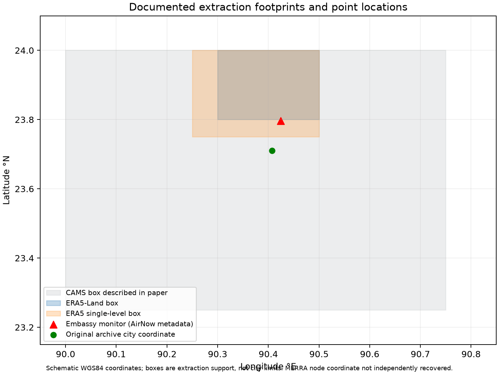
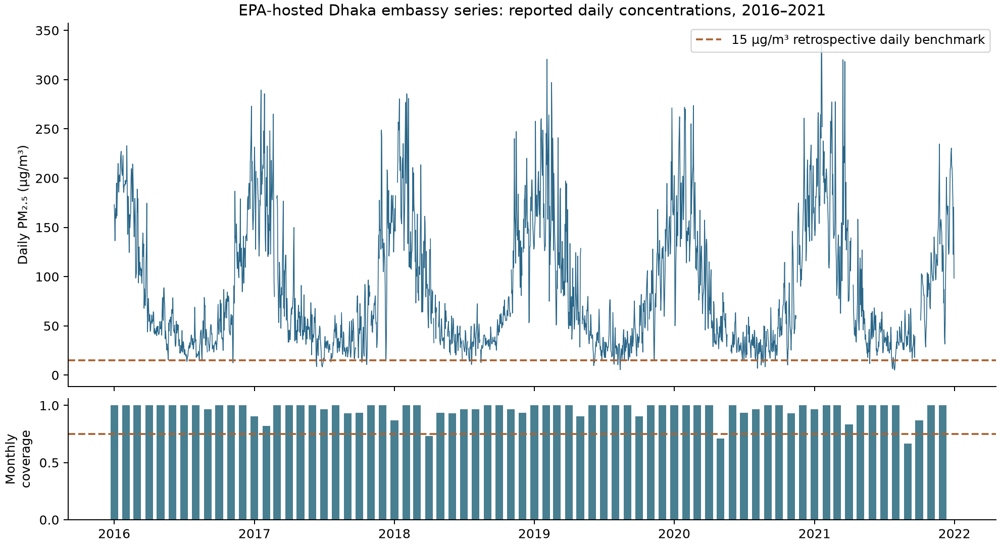
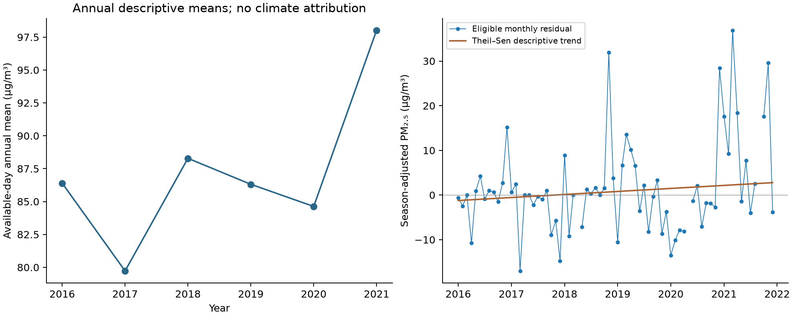
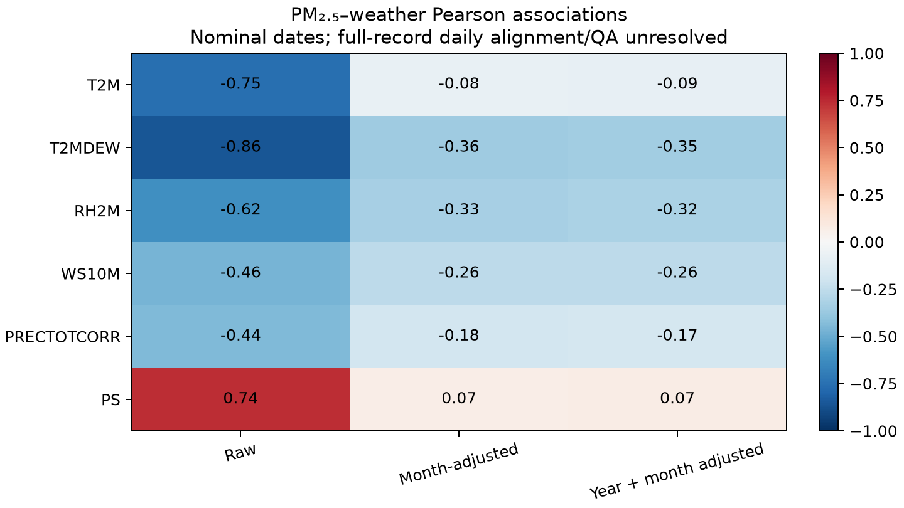
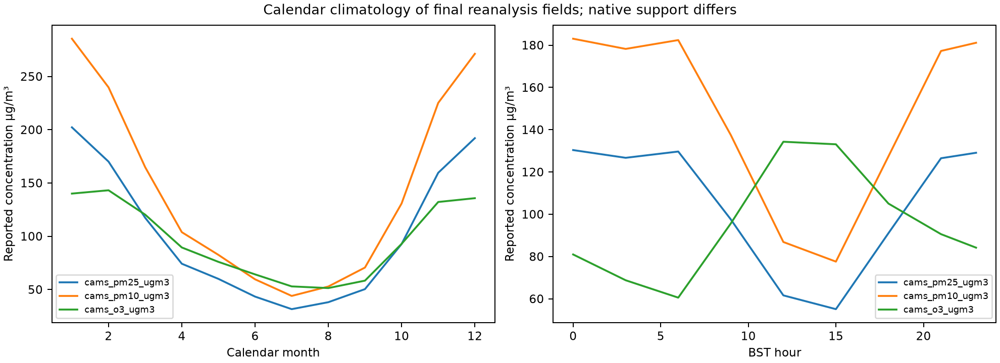
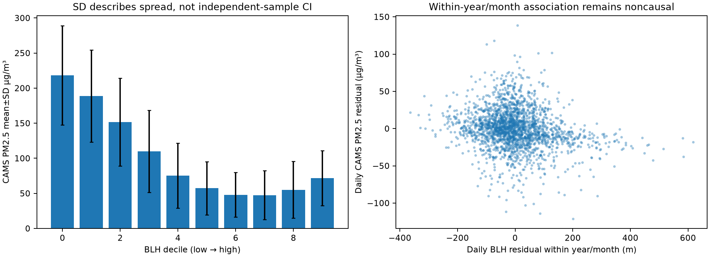
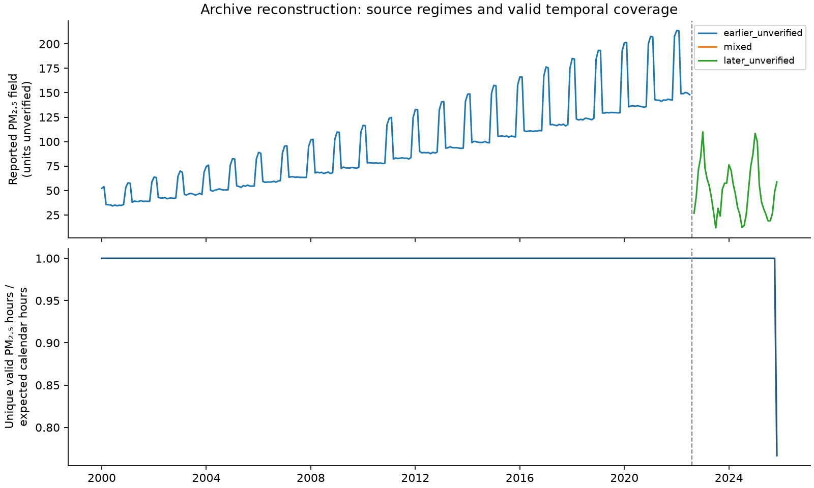

# Dhaka | Observed Air Quality, Meteorological Context and Reanalysis Evaluation

**Study area:** Dhaka, Bangladesh · **Observed PM₂.₅ period:** January 2016–December 2021 · **HyAQMet reproduction:** January 2017–December 2022 · **Separate archive audit:** January 2000–November 2025

**Data and methods:** EPA-hosted U.S. Embassy daily PM₂.₅, NASA POWER/MERRA-2 meteorology, the final HyAQMet reanalysis release, an AirNow hourly mirror, source and coverage audits, seasonal summaries, block-bootstrap uncertainty and chronological retrospective prediction.

> **Research status: completed exploratory analyses and reproducible source checks, not a peer-reviewed study or operational forecast.** The observed embassy record, regional reanalysis and original mixed-history archive are different evidence types. A regional model field is not a point-monitor observation; a correlation is not a causal effect. The original 2000–2025 archive is **not treated as 26 years of independently measured pollution**. Daily station QA, averaging conventions and publication latency remain incompletely documented.

**Read the study:** [Research brief](research_docs/RESEARCH_BRIEF.md) · [Detailed report](research_docs/analysis_results/ANALYSIS_REPORT.md) · [Report PDF](research_docs/analysis_results/ANALYSIS_REPORT.pdf) · [15-figure collection](research_docs/analysis_results/ANALYSIS_FIGURES.pdf) · [Citation](CITATION.cff)

## 1. What this research set out to investigate

Dhaka's air quality varies strongly through the year. This study asks which patterns are supported by observed PM₂.₅, whether weather adds information beyond seasonality and persistence, and how well a regional reanalysis product represents a monitored location.

### Research questions

1. **Observed pollution:** How large is the seasonal PM₂.₅ contrast, and how much of the daily record is actually available?
2. **Trend:** Does the short observed record support a trend once seasonality, temporal dependence and missing months are considered?
3. **Meteorological context:** How much of the pollution–weather association is shared seasonality, and does lagged weather improve retrospective prediction beyond simple baselines?
4. **Regional-product evaluation:** How closely does HyAQMet CAMS PM₂.₅ agree with available embassy observations, and what do correlation, concentration bias and spatial support each tell us?
5. **Reproducibility:** Which HyAQMet results can be reproduced from its final release, and what source or processing discrepancies remain?
6. **Historical archive reliability:** What can the original long archive support after checking its lineage, duplicated location values and August 2022 construction boundary?

### Objectives and approach

Separate observed and model-derived targets; retain missingness and source identity; use calendar-month summaries as the primary climatology; test trend uncertainty with temporal blocks; compare predictions on identical observed dates; reproduce the published dataset's diagnostics; and retain limitations beside each result.



*The point monitor, meteorological grid and regional air-quality products have different support. More rows, interpolation or additional source names do not automatically provide more independent evidence.*

## 2. Important results, in plain language

### Result A — Observed PM₂.₅ is strongly seasonal, with coverage made explicit

The EPA-hosted embassy series contains **2,117 observed daily values on a 2,192-day calendar**, or **96.58% coverage**, during 2016–2021. The **75 missing days remain missing**. The available-day mean is **87.18 µg/m³**, median **60.71** and maximum **340.79**. These summarize this monitored location and its published days, not city-wide personal exposure.




| Conventional seasonal window | Observed / calendar days | Mean PM₂.₅ |
|---|---:|---:|
| Winter, December–February | 527 / 542 | **172.02 µg/m³** |
| Pre-monsoon, March–May | 525 / 552 | 76.40 µg/m³ |
| Monsoon, June–September | 711 / 732 | **33.53 µg/m³** |
| Post-monsoon, October–November | 354 / 366 | 84.61 µg/m³ |

**Meaning:** The available winter mean is approximately **5.13 times** the monsoon mean. This pronounced observed seasonal contrast is supported by the record, while its causes cannot be isolated from these summaries. The windows contain 3/3/4/2 months; they are not equal-length independent seasonal replicates. Calendar-month results and equal-year weighting are also provided.

**2,068 of 2,117 observed days (97.69%)** are strictly above **15 µg/m³**, the WHO 2021 daily benchmark applied retrospectively. This is not an AQI calculation, regulatory-compliance determination or health-outcome estimate. Missing-day exceedances are unknown. A separate whole-period 95th-percentile screen identifies **56 observed exceedance runs**; the longest observed uninterrupted run lasts **six days**. Missing days can censor real episodes, and this descriptive threshold was not a prospective alarm rule.

*Evidence: [coverage and methods](research_docs/analysis_results/observed/methods_findings.md) · [monthly statistics](research_docs/analysis_results/observed/calendar_month_statistics.csv) · [seasonal table](research_docs/analysis_results/observed/four_season_statistics.csv) · [episode table](research_docs/analysis_results/observed/pooled_p95_episodes.csv).*

### Result B — The observed record does not establish an increasing trend

Using an exploratory **≥75% calendar-day coverage** screen, **69 of 72 monthly means** qualify. April 2018, May 2020 and September 2021 are excluded. After calendar-month adjustment, the Theil–Sen slope is **+0.677 µg/m³/year**.

| Residual moving-block uncertainty calculation | 95% interval, µg/m³/year |
|---|---:|
| 12-month blocks, 1,000 replicates | **−0.166 to +1.533** |
| 6-month sensitivity, 1,000 replicates | **−0.588 to +2.027** |



**Meaning:** Both intervals include zero. These calculations do **not establish an increasing trend**, and they do not prove that pollution was unchanged. Six years and conditional residual-block intervals cannot identify a climate-change effect. The intervals hold the estimated seasonal profile fixed and do not cover every source-QA or missingness uncertainty.

*Evidence: [trend inputs and intervals](research_docs/analysis_results/observed/season_adjusted_trend_intervals.csv) · [annual descriptive statistics](research_docs/analysis_results/observed/annual_statistics.csv).*

### Result C — Seasonality explains much of some weather associations; extra predictive skill is uncertain

Nominal-date temperature–PM₂.₅ Pearson correlation changes from **−0.755** to **−0.077** after calendar-month adjustment; pressure changes from **+0.736** to **+0.068**. The corresponding adjusted humidity, wind and rainfall correlations are approximately **−0.328, −0.260 and −0.184**.



**Meaning:** Strong raw temperature and pressure relationships largely reflect shared seasonal structure in this analysis. The remaining associations are descriptive; they do not identify the causal effect of changing weather or emissions. All explored lags and date offsets are retained, rather than selecting the most favorable relationship.

The prediction experiment starts with 2016–2017 training, then uses **monthly expanding refits** and daily observed lag updates. Fixed-alpha Ridge uses PM₂.₅ lags and calendar terms, with preprocessing fitted within each training fold. The primary weather branch uses **two-day-lagged UTC weather**: previous-UTC-day weather can overlap the beginning of a local target day. This conservative lag is an information-timing choice, not the lag with the best retrospective score. Actual publication latency is still unverified.

**2020–2021 retrospective one-day comparisons on the same 670 observed days**

| Model | MAE, µg/m³ | RMSE, µg/m³ | R² |
|---|---:|---:|---:|
| Previous-day persistence | 19.90 | 29.51 | 0.815 |
| Training-only calendar climatology | 25.56 | 37.00 | 0.709 |
| 365-day seasonal baseline | 34.10 | 49.26 | 0.484 |
| Ridge: PM₂.₅ lags + calendar | 18.84 | **27.74** | 0.836 |
| Ridge + conservative lag-two weather | **18.77** | **27.48** | 0.839 |


On **697 paired core/weather days**, the primary weather-minus-core RMSE difference is **−0.325 µg/m³**, with a 30-day block interval of **[−0.810, +0.382]**. This paired set differs from the 670-day all-model comparison because some baselines lack previous observations. The MAE interval also spans zero.

**Meaning:** The calendar/lag model improves on persistence in these inspected diagnostics, but **additional weather benefit is not established in the later period** under the conservative timing design. Lag-one weather produces better-looking numbers but can include overlapping target-day information. No universal best model, untouched-test certification or deployable forecast is claimed.

*Evidence: [methods and findings](research_docs/analysis_results/weather/findings.md) · [all model/year metrics](research_docs/analysis_results/weather/daily_metrics.csv) · [paired uncertainty](research_docs/analysis_results/weather/weather_increment_uncertainty.csv) · [lag/date sensitivity](research_docs/analysis_results/weather/associations_and_lags.csv).*

### Result D — HyAQMet follows observed variation, but correlation does not remove concentration bias

For **1,752 paired 2017–2021 days**, the nominal BST-day comparison of HyAQMet CAMS PM₂.₅ with the embassy reference gives:

| Diagnostic | Result |
|---|---:|
| Pearson correlation | **0.897** |
| Bias, regional model minus point reference | **+16.15 µg/m³** |
| MAE | 24.98 µg/m³ |
| RMSE | **34.23 µg/m³** |


Monthly means use **identical available reference days** and a ≥75% matched-day coverage rule: **57 months** qualify, with correlation **0.955** and RMSE **24.59 µg/m³**. The nominal post-monsoon October–November bias is approximately **+42.59 µg/m³**, so pooled scores hide seasonal error differences.

**Meaning:** A product can track variation closely while reporting systematically different concentrations. This is a conditional regional-product/point-monitor comparison, with differing spatial support. BST/UTC aggregation and ±1-day sensitivities remain visible; they are not a fitted timezone correction. A partial-period hourly AirNow mirror supports local daily labels—523 of 530 daily means match closely—but does not certify all years' QA or constitute another independent station.

*Evidence: [reference metrics](research_docs/analysis_results/reference/reference_metrics.csv) · [matched monthly comparison](research_docs/analysis_results/reference/matched_monthly_comparison.png) · [daily alignment sensitivities](research_docs/analysis_results/reference/daily_alignment_sensitivity.csv) · [methods and limits](research_docs/analysis_results/reference/findings.md).*

### Result E — Reproducing the final HyAQMet release reveals both useful consistency and unresolved discrepancies

The final deposited release reproduces **52,584 hourly rows and 42 fields** for 2017–2022, with no expected-hour gaps or missing numeric cells. The fields include time encodings and labels, not 42 independent physical measurements. CAMS has **17,528 native three-hourly source records** before hourly interpolation.



| Reproduction check | What the downloaded release shows |
|---|---|
| BLH–PM₂.₅ relationship | Direct hourly Pearson **−0.4904**, compared with **−0.65** printed in the paper; the reason remains unresolved. The lowest/highest BLH-decile mean contrast is **3.036×**, consistent with its approximate threefold description. |
| Six-season definitions | Released labels disagree with paper Table 3 at **13,968 hours**, while matching the public notebook's alternative dates. Codes are 1–6 in the release versus 0–5 described in the paper. **Both definitions are reported separately**; calendar months remain primary. |
| Precipitation | The final `precip_mm` field equals the source extract. Summing it as hourly water amounts yields **20,142–33,893 mm/year**, a strong accumulation-versus-rate warning. No corrected rainfall total is certified. |
| Solar radiation | The final maximum is **983.657 W/m²**, with no 01:00–04:00 BST values above 0.01 W/m². A downstream correction is present despite the raw-source description issue. |
| Collinearity | Centered maximum VIF falls from about **430,024** across 26 source candidates to **25.27** across 13 retained fields. This is a diagnostic of published sets, not proof of optimal selection or freedom from collinearity. |
| MERRA particulate proxy | The four-component sum is not a complete independently measured PM₂.₅ reference. BLH-scaled variants remain constructed sensitivity proxies, not validated calibration or source apportionment. |




**Meaning:** The release supports reproducible regional-product analyses, but a published flat file still requires checking units, accumulation conventions and definitions. Interpolation does not add independent observations; physical plausibility is not causal identification. The precipitation and season discrepancies are **exposed rather than silently repaired**, and no comparison between model products is presented as independent station validation.

*Evidence: [final-release findings](research_docs/analysis_results/hyaqmet/findings.md) · [source-field checks](research_docs/analysis_results/hyaqmet/final_vs_source_checks.csv) · [season cross-tabulation](research_docs/analysis_results/hyaqmet/released_vs_paper_season_counts.csv) · [precipitation diagnostic](research_docs/analysis_results/hyaqmet/annual_precipitation_diagnostic.csv) · [particulate sensitivities](research_docs/analysis_results/hyaqmet/pm25_intercomparison.csv).*

## 3. What happened to the original 2000–2025 archive?

The original Mendeley V2 CSV is now **identified by an exact published-checksum match**, but a known depositor is not proof of instrument lineage. Its Dhaka monthly means reproduce all **311 overlapping archived monthly values**. A clear construction boundary occurs on **4 August 2022**, not in the same form in HyAQMet's source series.

All **312 sampled PM₂.₅ hours** across four disjoint 2022–2025 windows match Open-Meteo `cams_global` at the same UTC-labelled times; PM₁₀ and ozone also match. This is strong common-model-lineage evidence for the sampled later segment—not certification of every row or the depositor's acquisition code. It does not explain the earlier history or assign earlier units/timezone.

The audit also finds identical Dhaka/Azimpur values across **28,968 overlapping hours**. Archived counts match their pooled row counts, whereas monthly means follow Dhaka alone. December 2025 has no original target, and November is partial. The repaired pipeline preserves source/coverage flags and avoids fabricating that target. Early generation/acquisition remains unresolved.



**Meaning:** The long archive is useful for a provenance investigation and a labelled model-product pilot. It cannot support a verified 26-year measured-pollution trend or a pollution-collapse narrative. It remains separate from the observed-reference results above.

*Evidence: [public source recovery](research_docs/ONLINE_SOURCE_RECOVERY.md) · [source manifest](research_docs/source_metadata/source_manifest.json) · [API fingerprint requests/counts](research_docs/source_metadata/online_recovery/openmeteo_fingerprints.json) · [rebuilt run report](research_docs/rebuilt_results/RUN_REPORT.md).*

## 4. Sources, methods and present limitations

| Evidence or method | Role and qualification |
|---|---|
| EPA-hosted embassy daily PM₂.₅, 2016–2021 | Published observed figure-support data, not recovered original hourly QA logs; one monitored location. Exact full-record daily rules remain open. |
| NASA POWER/MERRA-2 weather, 2016–2021 | Documented UTC daily meteorology at the embassy coordinates; model-derived and distinct from the old ERA5 export. Lag two reduces day-overlap risk but does not establish release latency. |
| HyAQMet final release, 2017–2022 | Regional reanalysis reproduction and conditional monitor comparison; native support, source conversions and accumulation concerns remain explicit. |
| Trend and uncertainty | Monthly coverage screen, seasonal adjustment, Theil–Sen and 6/12-month residual blocks; conditional intervals over six years, not climate attribution. |
| Prediction | Fixed regularization, training-fold preprocessing and monthly expanding refits; retrospectively inspected historical dates, not a newly untouched prospective test. |
| Original archive | Exact deposited-byte identity and bounded later-source fingerprints; early generation, source transition and old climate extraction are not fully recovered. |
| Scope of conclusions | No causal weather/emissions effects, health outcomes, personal exposure, intra-urban risk maps or emission-source apportionment were estimated. |

**Main research conclusion:** The available observed record supports pronounced seasonality, but not an established increasing short-period trend. Calendar and pollutant persistence are strong predictors; extra conservative-lag weather skill remains uncertain in 2020–2021. HyAQMet tracks much of the observed variation while retaining concentration differences and processing questions that correlation alone cannot resolve.

## 5. Research materials and reproducibility

| Research component | Methods and results | Tables and figures |
|---|---|---|
| Observed coverage, climatology, episodes and trend | [Observed findings](research_docs/analysis_results/observed/methods_findings.md) | [Observed outputs](research_docs/analysis_results/observed/) |
| Weather associations and retrospective prediction | [Weather findings](research_docs/analysis_results/weather/findings.md) | [Predictions, metrics and figures](research_docs/analysis_results/weather/) |
| Conditional monitor comparison | [Reference findings](research_docs/analysis_results/reference/findings.md) | [Pairing, uncertainty and figures](research_docs/analysis_results/reference/) |
| HyAQMet final-release reproduction | [HyAQMet findings](research_docs/analysis_results/hyaqmet/findings.md) | [Diagnostics and figures](research_docs/analysis_results/hyaqmet/) |
| Original archive reconstruction | [Run report](research_docs/rebuilt_results/RUN_REPORT.md) | [Rebuilt data and audits](research_docs/rebuilt_results/) |

**Reports:** [Detailed research report](research_docs/analysis_results/ANALYSIS_REPORT.md) · [Typeset report PDF](research_docs/analysis_results/ANALYSIS_REPORT.pdf) · [Portable summary and figure collection](research_docs/analysis_results/ANALYSIS_FIGURES.pdf) · [Executed analysis inventory](research_docs/analysis_results/analysis_inventory.json).

From the repository root, prepare Python 3.12 and the pinned environment:

```bash
uv venv --python 3.12 .venv
uv pip sync --python .venv/bin/python --require-hashes requirements.lock
uv pip install --python .venv/bin/python --no-deps -e .
.venv/bin/python -m unittest discover -s tests -v
```

Follow [REPRODUCE.md](research_docs/analysis_results/REPRODUCE.md) for public-source acquisition, the four analysis tracks and report generation. [Project metadata](pyproject.toml), the [hash-pinned dependency file](requirements.lock) and input/script manifests record the computational environment. Original inputs and historical exports are preserved; analysis commands use fresh output directories. Tests and successful reproduction establish computational behavior, not missing station QA or original acquisition history.

### Historical exports retained for traceability

[Phase 2 pollution dynamics](Phase_2_Pollution_Dynamics/) · [Phase 3 legacy climate integration](Phase_3_Climate_Integration/) · [Phase 3 legacy model splits and scores](Phase_3_Modeling/). These are archived computations, **not the primary results presented above**. See [repair scope and evidence requirements](research_docs/REPAIR_PLAN_AND_DATA_REQUIREMENTS.md) and [depositor questions](research_docs/QUESTIONS_FOR_DATA_DEPOSITOR.md) for unresolved original-source issues.

## 6. Source credit

- **Barua, A.; Basak Shuvo, M.; Ali, S.; Khan, A. U.; and Saad, A. M.** *HyAQMet: Hourly Air Quality and Meteorology Dataset for Dhaka*, Geoscience Data Journal, [doi:10.1002/gdj3.70111](https://doi.org/10.1002/gdj3.70111). The dataset by **Adity Barua and Mrinal Basak Shuvo** is available at [Zenodo doi:10.5281/zenodo.20705735](https://doi.org/10.5281/zenodo.20705735), CC BY 4.0; [original processing repository](https://github.com/AdityBarua10/HyAQMet).
- **Golam Sarwar / U.S. EPA research data.** *Characterizing variations in ambient PM₂.₅ concentrations at the U.S. Embassy in Dhaka, Bangladesh using observations and the CMAQ modeling system*, [doi:10.23719/1528454](https://doi.org/10.23719/1528454). This study uses the published observed columns, not CMAQ or weather-normalized columns as observations.
- **NASA POWER / MERRA-2.** Daily meteorology from the [NASA POWER API](https://power.larc.nasa.gov/); [exact request, units and checksum](research_docs/source_metadata/online_recovery/nasa_power_embassy_2016_2021_manifest.json).
- **AirNow DOS observation providers; secondary archive by Ryza Rynazal.** [Hourly PM₂.₅ concentrations for 12 cities, doi:10.6084/m9.figshare.12687695.v2](https://doi.org/10.6084/m9.figshare.12687695.v2), used for a station-day convention sensitivity—not another independent site. [Recovery and attribution details](research_docs/ONLINE_SOURCE_RECOVERY.md).
- **Paul, Tapon (2026).** *Bangladesh Air Quality Index (AQI) Dataset (2000–2025): Historical Hourly Air Pollution Data Across 103 Cities*, Mendeley Data V2, [doi:10.17632/9j447cynb9.2](https://doi.org/10.17632/9j447cynb9.2), CC BY 4.0. The title claims 103 cities; the deposited pollutant CSV contains 30 city names and its separate location metadata has 103 rows.
- **Open-Meteo and CAMS data providers.** [Air Quality API](https://open-meteo.com/en/docs/air-quality-api), used for bounded source-fingerprint checks. CAMS Global archives and CAMS EAC4 reanalysis are related product families, not interchangeable datasets.

Original data and paper authors retain credit for their materials. This repository contributes the documented reconstruction, analyses, comparisons and limitations; reuse does not transfer dataset authorship.
