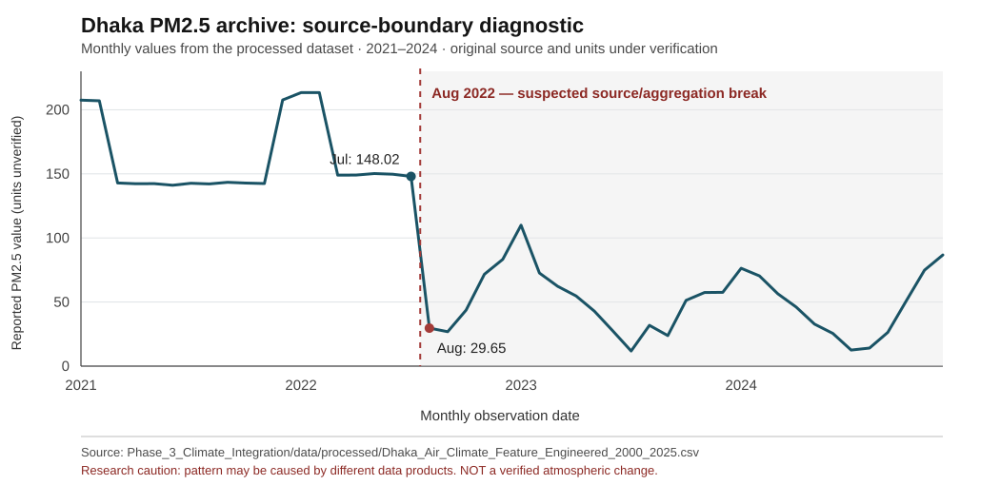

# Dhaka | Air Pollution Dynamics, Climate Context & Health-Relevant Exposure Indicators

**Study area:** Dhaka, Bangladesh · **Archive period:** January 2000–December 2025 · **Primary analysis unit:** month (312 records)  
**Research status (27 October 2026): Exploratory results available; historical data provenance, source harmonization and independent validation are ongoing.**  
**Type:** Independent environmental data-science research; not a peer-reviewed publication or a validated estimate of health outcomes.

> **Read this before interpreting the figures.** The processed PM2.5 series has an abrupt change around **August 2022**. The July 2022 monthly mean is **148.02** and August is **29.65** in the uploaded feature table; the monthly `observations` field simultaneously changes from **744** to **1,392**. The source and aggregation history need verification. This discontinuity may affect reported trends, change points, correlations and model scores. **These plots are outputs of the archived data, not evidence that measured ambient pollution fell abruptly.** See [Data provenance and validation status](research_docs/DATA_PROVENANCE_AND_VALIDATION.md).

## 1. Research questions

1. What patterns and apparent changes appear in the archived Dhaka air-pollution series between 2000 and 2025?
2. How do reported PM2.5 levels vary seasonally, and how sensitive are those patterns to data availability and source changes?
3. How do satellite aerosol indicators and reanalysis weather variables co-vary with PM2.5, without assuming causation?
4. Do statistical or machine-learning models outperform straightforward temporal baselines under chronological validation?
5. What can the current datasets support about pollution exposure—and what **cannot** be concluded about health outcomes?

## 2. Data and temporal coverage

| Data group | Variables / source description | Coverage in repository | Important qualification |
|---|---|---|---|
| Historical air-quality archive | PM2.5, PM10, gases, AQI; uploaded/reprocessed historical air-quality records | 2000–2025 (monthly aggregates) | **Underlying source identity, station representativeness, units and harmonization not yet verified.** Do not label the entire series as government ground-monitor measurements. |
| Earth observation | MODIS aerosol optical depth (AOD), MODIS land-surface temperature (LST), Sentinel-5P NO₂ | AOD 267/312, LST 271/312, NO₂ 91/312 monthly availability flags | Sensors have different operating periods, retrieval gaps and spatial support; flags do not prove reference accuracy. |
| Climate/reanalysis | ERA5-Land meteorological variables (temperature, dewpoint, precipitation, pressure, wind) | Monthly feature table, 2000–2025 | Reanalysis is not a direct pollution-station observation. Extraction provenance and units remain under review. |
| Machine-learning samples | Forecasting and attribution-design matrices | Train: 2000–2020 (252 months); validation: 2021–2023 (36); test: 2024–2025 (24) | An out-of-time split alone does not establish leak-free *operational forecasting*. Lag timing, preprocessing and changing source regimes need audit. |
| Related comparison data (not merged) | [Albab Hasan: Bangladesh district-level weather and pollution](https://github.com/Albab-Hasan/Bangladesh-District-Level-Weather-Pollution-DataSet) | Published daily district files from August 2025 onward | OpenWeatherMap API-derived data, **not independent DoE station truth**. Different scales and AQI definitions require harmonization before comparison. |

The [Bangladesh Department of Environment (DoE)](https://doe.gov.bd/pages/static-pages/6922dfba933eb65569e23b0a) publishes AQI reports that are relevant for future station-based cross-checking; **no complete match against original DoE station observations has yet been established**.

## 3. Exploratory findings, with caveats

### Finding A — A source-quality discontinuity dominates interpretation

In the processed monthly table, annual PM2.5 means are **158.71 (2021)**, **119.01 (2022)** and **50.31 (2023)** in the dataset's reported concentration field. The pronounced shift coincides with changing row characteristics and requires source tracing. It must not be interpreted as an observed environmental recovery.



*Figure 1. Diagnostic plot of archived monthly PM2.5 values around the suspected 2022 source boundary. The vertical marker is an audit flag, **not** a verified physical change point. [Underlying monthly table]([Phase_3_Climate_Integration/data/processed/Dhaka_Air_Climate_Feature_Engineered_2000_2025.csv](https://github.com/Bipul-roy-AI/Dhaka-Air-Pollution-Climate-Health-Intelligence/blob/main/Phase_3_Climate_Integration/data/processed/Dhaka_Air_Climate_Feature_Engineered_2000_2025.csv)).*

### Finding B — Apparent long-term and seasonal patterns

The Phase 2 archives contain descriptive statistics, Mann–Kendall analysis, pollutant correlations, PCA and change-point tests. Their findings are **historical computations on the current input series**, not confirmed trends in a stable independent instrument record. The Phase 2 summary reports PM2.5–PM10 Pearson **r = 0.992**, and PCA component shares of **60.47%, 22.90% and 10.41%** for the first three components. Common data construction, autocorrelation, missing data and source changes may influence these numbers.


*Figure 2. Archived annual trend figure. **Data-source comparability is unverified**; do not infer a confirmed 2000–2025 atmospheric trend.*


*Figure 3. Exploratory monthly seasonal cycle; source regimes and monitoring coverage may bias the pooled seasonal profile.*


*Figure 4. Archived monthly distributions. Derived from the current mixed-provenance series.*

### Finding C — Observation coverage and extreme-event screening


*Figure 5. Reported observation-count indicator. Its units and counting method must be documented before interpreting it as station availability.*


*Figure 6. Archived frequency of threshold-defined PM2.5 extremes, exploratory only. Threshold definition and comparable source coverage require review.*


*Figure 7. Archived yearly extreme-frequency figure, not a validated change in exposure risk.*

### Finding D — Climate relationships and preliminary model evaluation

Pearson/Spearman correlations, partial correlations, lags and VIF analyses have been exported in [Phase 3 results](Phase_3_Climate_Integration/results/). Several predictors are collinear: archived VIF values include **dewpoint 47.86** and **temperature 33.98**. Co-variation does **not** prove pollution causation.

The following scores are **as saved in the repository**, not independently rerun or publication-ready:

| Archived model and track | Validation RMSE | Test RMSE | Test R² |
|---|---:|---:|---:|
| Linear Regression, forecasting | 38.79 | 12.21 | 0.788 |
| Ridge, forecasting | 40.14 | 12.47 | 0.778 |
| Random Forest, forecasting | 67.22 | 17.75 | 0.551 |
| XGBoost, forecasting | 64.88 | 18.03 | 0.537 |
| Linear Regression, environmental-feature attribution design | 62.69 | 68.10 | −5.609 |
| Random Forest, environmental-feature attribution design | 60.81 | 89.51 | −10.419 |

*Source: [model_evaluation_metrics.csv](Phase_3_Modeling/results/model_evaluation_metrics.csv). RMSE units inherit the unresolved target units. The environmental-feature track is **not causal attribution**. Negative R² indicates poor predictive fit relative to a constant test-mean reference. Results require clean reruns, baseline comparisons, leakage checks and source-regime tests before scientific interpretation.*

## 4. Research workflow and existing outputs

```text
Historical air-quality archive (provenance audit pending)
             + Satellite retrievals + Reanalysis
                         |
            Monthly alignment + availability flags
                         |
           Descriptive patterns / trends / PCA
                         |
         Climate relationships and VIF diagnostics
                         |
          Chronological ML train / validate / test
                         |
         Evaluation tables + diagnostic visualizations
                         |
            Independent source validation (OPEN)
```

| Folder | Contents |
|---|---|
| [Phase_2_Pollution_Dynamics](Phase_2_Pollution_Dynamics/) | Annual tables, trend tests, PCA, correlations, change points, methodology |
| [Phase_3_Climate_Integration](Phase_3_Climate_Integration/) | Source/processed monthly CSVs, missingness flags, climate features, six figures and statistical results |
| [Phase_3_Modeling](Phase_3_Modeling/) | Chronological split CSVs, stored model metrics and predictions |
| [research_docs](research_docs/) | Source-quality warning, provenance notes, validation and future reproduction priorities |

**Reproducibility status:** The numerical CSVs and selected figures are public. The complete original ground-data construction, source reconciliation, feature-engineering and model-training pipelines are **not fully reproducible from committed scripts alone**. The repository reports computed results, but this publication update did **not** independently rerun its original experiments.

## 5. Health relevance versus measured health outcomes

Ambient PM2.5 is relevant to human exposure and public-health research. **This project has no verified linked morbidity, mortality, hospital admission or individual exposure dataset.** It does not estimate disease burden, causal health effects or health-risk maps. Such claims would require appropriately matched health, population and exposure data and explicit uncertainty analysis.

## 6. Main limitations and verification in progress

- **Unresolved historical source provenance:** especially the abrupt August 2022 shift and observed-value precision/counting changes. Confirm original file lineage, station identity, timestamp definition, units and any synthetic or modeled portions.
- **Non-comparable measurements:** distinguish DoE monitor data, Open-Meteo/CAMS products, OpenWeatherMap products, satellite retrievals and climate reanalysis. No interchangeability is assumed.
- **Satellite missingness:** AOD and LST are incomplete; Sentinel-5P NO₂ begins much later than 2000. Avoid backfilling unsupported periods without clear models and flags.
- **Statistical inference:** reassess trend significance with autocorrelation, seasonality, multiple testing, source breaks and uncertainty.
- **Prediction interpretation:** rerun reproducibly with preprocessing fitted on training periods only, appropriate causal availability of lagged variables, seasonal/persistence baselines, and evaluation by regime.
- **Health interpretation:** exposure context only; no health-outcome inference.
- **External validation:** DoE station records and newer independent datasets have not yet been harmonized or used to validate these results.

[Read the detailed provenance and verification checklist](research_docs/DATA_PROVENANCE_AND_VALIDATION.md).

## 7. Related sources, credit and status

- Bangladesh DoE: [Air Quality Index reports](https://doe.gov.bd/pages/static-pages/6922dfba933eb65569e23b0a) — **potential verification source**, not yet harmonized.
- Albab Hasan: [Bangladesh District-Level Weather & Pollution Dataset](https://github.com/Albab-Hasan/Bangladesh-District-Level-Weather-Pollution-DataSet) — OpenWeatherMap daily district series since August 2025; not included in the reported figures.
- Source data and methodology: repository files linked above. The original provenance of the long historical pollutant series remains under investigation.

**Current assessment:** Exploratory analyses published; further data validation, statistical verification and reproducible reruns are ongoing. This README documents what is presently in the repository, without presenting unverified data-source differences as environmental findings.
