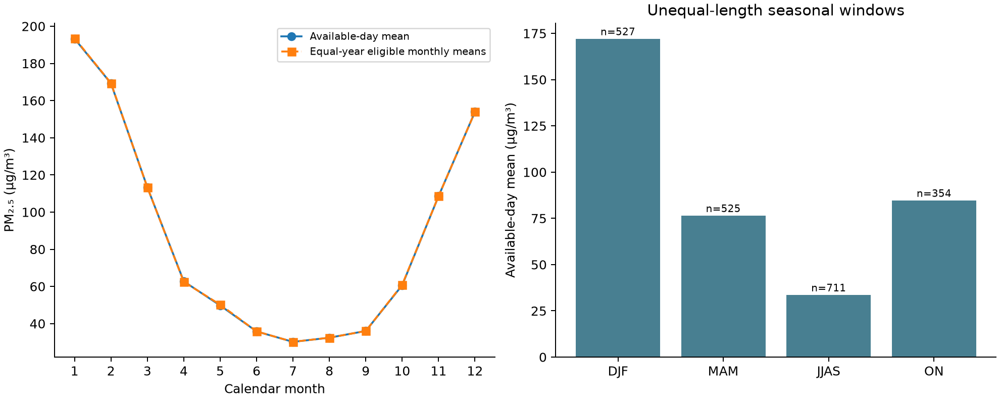
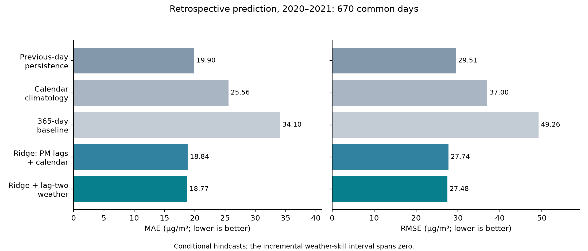

# Seasonal PM₂.₅ Patterns and Meteorological Associations in Dhaka, Bangladesh

## 1. Introduction and objectives

This study examines how observed fine particulate pollution varies across months and seasons in Dhaka, how it relates to meteorological conditions, and whether weather adds useful information to temporal prediction baselines. PM₂.₅ describes particles with aerodynamic diameter at or below 2.5 µm. Shared seasonality can produce strong weather–pollution correlations, so the analysis separates seasonal patterns from within-season associations.

Objectives:

1. Quantify observed PM₂.₅ coverage, seasonal variation and short-period trend uncertainty.
2. Examine weather associations after calendar adjustment and evaluate conservative retrospective prediction against temporal baselines.
3. Describe observed high-pollution episodes and test the sensitivity of conclusions to coverage, seasonal calendars and evaluation period.

## 2. Data and methods

### 2.1 Data and temporal support

Observed concentrations were extracted from the observed columns of EPA-hosted figure-support data for the U.S. Embassy in Dhaka, covering 2016–2021 [1]. Missing dates were retained. The source contains published daily values; full hourly QA logs and the exact full-record averaging rule were not recovered.

NASA POWER supplied UTC daily temperature, dewpoint, relative humidity, wind, precipitation and pressure at the embassy coordinates (23.796374° N, 90.424614° E) for the same 2,192 days [2]. All six fields were complete. These are model-derived meteorological estimates, with native units preserved; this acquisition is separate from the earlier climate/satellite table.

The earlier 2000–2025 archive [6] was excluded from environmental trend and prediction claims because its measurement lineage, units and timezone remain unresolved and its numerical characteristics change sharply on **4 August 2022**. That boundary does not establish a real pollution decrease. Its computational audit is retained in [data-selection notes](DATA_SELECTION.md).

### 2.2 Descriptive and statistical analysis

Available-day statistics report explicit denominators. Calendar months are the primary climatology; seasonal windows are December–February (DJF), March–May (MAM), June–September (JJAS) and October–November (ON). Two alternative six-season date calendars [5] are retained in supplementary tables, with their exact boundaries in the analysis metadata; neither replaces the primary calendar-month summaries. The WHO 2021 daily value of 15 µg/m³ was used as a retrospective benchmark [4].

Monthly trend inputs required at least 75% of calendar days. Calendar-month medians were subtracted before Theil–Sen estimation. Uncertainty used 1,000 residual moving-block replicates with 12-month blocks and a six-month sensitivity, conditional on the estimated seasonal profile and approximately stationary residuals.

Pearson/Spearman weather associations were examined with calendar-month and year/month adjustments. Daily date offsets of −1/0/+1 were retained as sensitivity checks. These screens are exploratory associations.

### 2.3 Retrospective prediction and daily timing

Ridge regression, a regularized linear model with fixed penalty α = 1, used PM₂.₅ lags 1/7/365, annual sine/cosine terms and training-fold median imputation/scaling. Initial training covered 2016–2017, followed by monthly expanding refits and daily observed-lag updates. The weather extension used two-day-lagged UTC temperature, humidity, wind, rainfall and pressure. This avoids previous-UTC-day overlap with a local target day; actual publication latency remains unverified.

Model comparisons used identical observed dates. Weather-increment intervals used 1,000 paired seven-/30-day calendar-block replicates. Both historical evaluation periods were inspected retrospectively. A secondary hourly AirNow archive [3] informed daily-label interpretation: 523 of 530 daily means matched within 0.0001 µg/m³ under local labels. This is a check on the same station, rather than another monitoring site, and does not certify the full record’s averaging or quality rules.

## 3. Results

### 3.1 Observed coverage and concentration distribution

| Year | Observed / calendar days | Coverage | Mean PM₂.₅, µg/m³ |
|---|---:|---:|---:|
| 2016 | 365 / 366 | 99.73% | 86.40 |
| 2017 | 352 / 365 | 96.44% | 79.72 |
| 2018 | 344 / 365 | 94.25% | 88.29 |
| 2019 | 359 / 365 | 98.36% | 86.31 |
| 2020 | 352 / 366 | 96.17% | 84.63 |
| 2021 | 345 / 365 | 94.52% | 98.02 |
| **All years** | **2,117 / 2,192** | **96.58%** | **87.18** |

These available-day means represent one location; changing coverage may affect comparisons. Overall PM₂.₅ had a mean of **87.18**, median of **60.71** and maximum daily value of **340.79 µg/m³**. The higher mean than median reflects the influence of high-concentration days. [Annual table](results/annual_pm25.csv) and [summary](results/observed_summary.json).

The lower panel shows monthly coverage. Missing days remain unknown throughout the analysis.

### 3.2 Monthly and seasonal variation

| Seasonal window | Observed / calendar days | Mean PM₂.₅, µg/m³ |
|---|---:|---:|
| Winter, DJF | 527 / 542 | **172.02** |
| Pre-monsoon, MAM | 525 / 552 | 76.40 |
| Monsoon, JJAS | 711 / 732 | **33.53** |
| Post-monsoon, ON | 354 / 366 | 84.61 |

January had the highest pooled monthly mean (**193.29 µg/m³**), while July had the lowest (**30.16 µg/m³**). The winter mean was **5.13 times** the monsoon mean. The unequal 3/3/4/2-month windows require separate coverage denominators. The figure also compares available-day and equal-year monthly weighting. [Monthly](results/monthly_pm25.csv) and [seasonal](results/seasonal_pm25.csv) tables provide the underlying values.

The [published-date](results/six_season_sensitivity.csv) and [alternative two-month](results/six_season_release_sensitivity.csv) six-season summaries apply both calendars to these observations and report their separate coverage.

### 3.3 High-pollution days and episodes

| Indicator | Result |
|---|---:|
| Observed days above 15 µg/m³ | **2,068 / 2,117 (97.69%)** |
| Pooled observed-day 95th percentile | **212.77 µg/m³** |
| Consecutive observed runs above that percentile | **56** |
| Longest uninterrupted observed run | **6 days** |

These are descriptive indicators. The 15 µg/m³ comparison does not estimate regulatory compliance, individual exposure or health outcomes. The percentile threshold was estimated from the full period, rather than selected as a prospective alarm. Missing days break and may censor episodes, so six days is the longest recorded uninterrupted run, not necessarily the true longest episode. [Episode table](results/episodes.csv).

### 3.4 Short-period trend remains uncertain

Sixty-nine of 72 months met the coverage screen. April 2018, May 2020 and September 2021 were excluded.

| Season-adjusted estimate | Result, µg/m³/year |
|---|---:|
| Theil–Sen slope | +0.677 |
| 12-month block 95% interval | **−0.166 to +1.533** |
| Six-month sensitivity interval | **−0.588 to +2.027** |

Both intervals span zero, so this analysis does **not establish an increasing trend**. Neither absence of change nor climate-change attribution is established. [Trend results](results/trend.csv).

### 3.5 Weather associations after seasonal adjustment

| Weather variable | Raw Pearson r | Calendar-month-adjusted r |
|---|---:|---:|
| Temperature | −0.755 | −0.077 |
| Relative humidity | −0.616 | −0.328 |
| Wind speed | −0.464 | −0.260 |
| Rainfall | −0.440 | −0.184 |
| Pressure | +0.736 | +0.068 |

Temperature and pressure associations attenuate substantially after calendar adjustment, showing how shared seasonality influences raw correlations. Remaining associations are descriptive.

With all six weather predictors, the maximum variance inflation factor (VIF, a measure of predictor redundancy) was **267.72**. Omitting dewpoint, which is physically related to temperature and relative humidity, reduced the maximum to **4.49**. The prediction model therefore uses the other five fields. This choice addresses redundancy; it does not establish an optimal predictor set or causal effects. [Correlations](results/weather_correlations.csv) and [weather VIF](results/weather_vif.csv).

### 3.6 Retrospective prediction and period dependence

**2020–2021 common-case retrospective prediction: 670 days**

MAE is mean absolute error; RMSE is root mean squared error and weights large errors more heavily. Lower values indicate better predictions.

| Model | MAE, µg/m³ | RMSE, µg/m³ | R² |
|---|---:|---:|---:|
| Previous-day persistence | 19.90 | 29.51 | 0.815 |
| Calendar climatology | 25.56 | 37.00 | 0.709 |
| 365-day seasonal baseline | 34.10 | 49.26 | 0.484 |
| Ridge: PM₂.₅ lags + calendar | 18.84 | **27.74** | 0.836 |
| Ridge + lag-two weather | **18.77** | **27.48** | 0.839 |

Calendar/lag Ridge improved on persistence in this inspected comparison. Added weather made a small difference in 2020–2021.

| Evaluation period | Paired core/weather days | Weather minus core RMSE, µg/m³ | 30-day block 95% interval |
|---|---:|---:|---:|
| 2018–2019 | 703 | **−1.274** | **−1.847 to −0.278** |
| 2020–2021 | 697 | **−0.325** | **−0.810 to +0.382** |

Negative differences favor added weather. The earlier period shows an improvement under this conditional interval, but the later interval spans zero, so later-period incremental benefit is **not established**. The paired core/weather cases differ from the 670-day all-model intersection. The later-period MAE interval also spans zero. This period dependence limits claims of generalizable weather skill. [Model metrics](results/models.csv) and [paired uncertainty](results/weather_increment.csv).

## 4. Discussion and limitations

The clearest findings are the large seasonal contrast and frequent high daily concentrations at the monitored location. Apparent temperature and pressure relationships largely attenuate after calendar adjustment. Temporal structure provides useful prediction baselines, while incremental weather skill varies between periods.

The embassy series represents one location, with incompletely recovered daily quality-assurance and averaging rules. Coverage screens cannot eliminate bias from non-random missingness. NASA days are UTC; lag-two weather reduces interval-overlap risk but does not demonstrate operational release availability. Model evaluation is retrospective, with conditional block intervals and six years of observations. The earlier archive cannot extend this record into a verified 26-year monitoring study. No causal emissions, health-outcome, personal-exposure, source-apportionment or climate-change attribution claims follow from these data.

## 5. Further research

Priority work is to verify station-day quality rules and publication latency, obtain longer source-consistent monitoring records, and register a prospective prediction period before model selection. Additional stations would test geographical generalization. Recovering the original climate/satellite extraction code and the earlier archive’s acquisition history could support a separately validated extension. Future models should demonstrate benefit over temporal baselines on common cases, with uncertainty reported for both periods and high-pollution days.

## 6. Conclusion

Dhaka’s available observed record shows pronounced seasonal PM₂.₅ variation, with winter concentrations about five times the monsoon mean and frequent exceedance of the retrospective daily benchmark. The short-period trend remains uncertain. Calendar and pollutant persistence explain substantial predictive structure, while conservative weather additions do not establish later-period incremental benefit. These results support a focused, reproducible account of the 2016–2021 monitored period.

## 7. References

1. **Sarwar, Golam / U.S. EPA.** *Characterizing variations in ambient PM₂.₅ concentrations at the U.S. Embassy in Dhaka, Bangladesh using observations and the CMAQ modeling system*. Research data. [doi:10.23719/1528454](https://doi.org/10.23719/1528454).
2. **NASA POWER.** Daily meteorological data and API documentation. [Official POWER portal](https://power.larc.nasa.gov/).
3. **Rynazal, Ryza.** *Hourly PM₂.₅ concentrations for 12 cities*, secondary AirNow DOS archive, V2. Figshare, CC BY 4.0. [doi:10.6084/m9.figshare.12687695.v2](https://doi.org/10.6084/m9.figshare.12687695.v2).
4. **World Health Organization (2021).** *WHO global air quality guidelines*. [Official guidelines](https://www.who.int/publications/i/item/9789240034228).
5. **Barua, A.; Basak Shuvo, M.; Ali, S.; Khan, A. U.; Saad, A. M.** *HyAQMet: Hourly Air Quality and Meteorology Dataset for Dhaka*. Geoscience Data Journal. Background reference for seasonal-analysis approaches; its dataset reproduction and comparison results are outside this study. [doi:10.1002/gdj3.70111](https://doi.org/10.1002/gdj3.70111).
6. **Paul, Tapon (2026).** *Bangladesh Air Quality Index (AQI) Dataset (2000–2025): Historical Hourly Air Pollution Data Across 103 Cities*. Mendeley Data, V2. Source of the excluded earlier archive, retained for provenance. [doi:10.17632/9j447cynb9.2](https://doi.org/10.17632/9j447cynb9.2).
