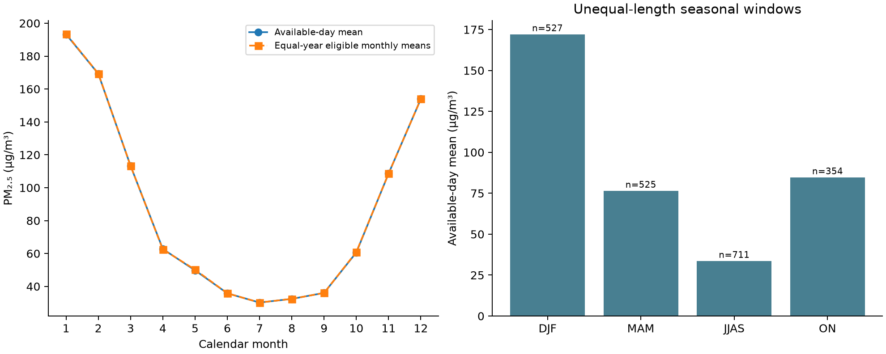
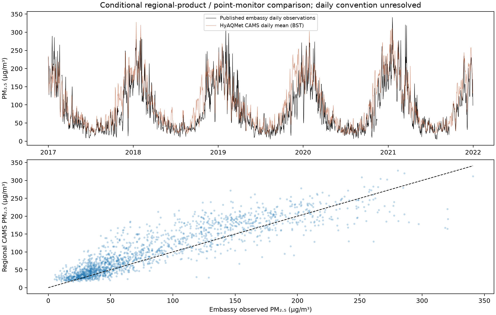
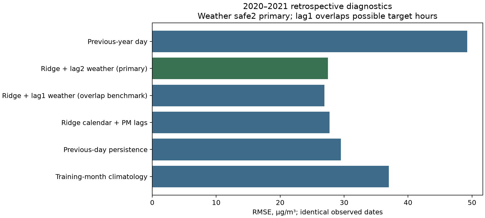

# Dhaka PM₂.₅: seasonality, regional reanalysis agreement and conditional prediction

**Researcher:** Bipul Roy · **Study area:** Dhaka, Bangladesh 
**Observed-reference period:** 2016–2021 · **HyAQMet comparison period:** 2017–2022 
**Status:** Completed reproducible exploratory analysis; not a peer-reviewed publication or an operational forecast evaluation.

[Research overview](../README.md) · [Full report](analysis_results/ANALYSIS_REPORT.md) · [Report PDF](analysis_results/ANALYSIS_REPORT.pdf) · [Figures PDF](analysis_results/ANALYSIS_FIGURES.pdf) · [Reproduce the analysis](analysis_results/REPRODUCE.md)

## Research summary

This study examines the seasonal behavior of observed Dhaka PM₂.₅, the agreement between regional atmospheric reanalysis and published station observations, and the additional predictive value of meteorological inputs beyond pollution persistence and the annual cycle. It keeps station observations, model-derived products and a mixed-provenance historical archive as distinct evidence sources.

The recovered EPA-hosted embassy series contains **2,117 observed daily values out of 2,192 calendar days** in 2016–2021 (96.58% coverage). Winter mean concentration was **172.02 µg/m³**, compared with **33.53 µg/m³** during June–September. A season-adjusted monthly Theil–Sen slope of **+0.677 µg/m³/year** had a conditional 12-month block-bootstrap interval of **−0.166 to +1.533**, so the short record does not establish an increasing trend.

For **1,752 paired days in 2017–2021**, HyAQMet CAMS daily means and the embassy reference had Pearson **r = 0.897**, with model-minus-reference bias **+16.15 µg/m³** and RMSE **34.23 µg/m³** under nominal Bangladesh-local daily alignment. Geographic support, averaging-time conventions and original station QA limit the interpretation of these paired diagnostics.

A retrospective prediction experiment fitted preprocessing within each training fold and compared baselines with fixed-regularization regression. On **670 common 2020–2021 days**, persistence, calendar/PM-lag Ridge and Ridge with conservative lag-two weather had RMSE **29.51**, **27.74** and **27.48 µg/m³**, respectively. The paired weather-increment uncertainty includes zero; an added weather benefit is not established in that later period. The lag-two choice protects against UTC weather intervals extending into a Bangladesh-local target day. Actual source publication latency remains unverified.

The work also reproduces the final HyAQMet release's structural, seasonal, VIF and inter-product diagnostics. It exposes discrepancies between the paper and released season labels and an unresolved precipitation accumulation concern. These are reported as source-quality findings rather than silently repaired.

## Questions and evidence

| Research question | Evidence | Supported interpretation |
|---|---|---|
| How does observed PM₂.₅ vary through the year? | EPA-hosted published daily embassy measurements; coverage-aware monthly and seasonal summaries | Strong site-level seasonal contrast during the observed period |
| Does the short record establish a long-term increase? | Season-adjusted monthly slope; 6- and 12-month residual block intervals | The intervals include zero; no established increase or climate attribution |
| How well does regional reanalysis agree with a point monitor? | Matched daily/monthly CAMS–EPA comparisons; BST/UTC/date-offset sensitivities | High co-variation can coexist with concentration differences and spatial mismatch |
| Does weather add prediction skill? | Expanding monthly refits; backward calendar lags; common-case baselines; paired block uncertainty | The primary later-period weather increment remains uncertain |
| Can the original 2000–2025 archive be treated as a continuous monitored record? | Published-file checksum, source fingerprints, unique-hour reconstruction and source-boundary audit | Deposited-file identity is confirmed; full observational lineage is unresolved |

## Selected evidence

*Observed point-monitor daily values, 2016–2021. The four seasonal windows have unequal lengths; calendar-month summaries are primary. [Season table](analysis_results/observed/four_season_statistics.csv).*

*Nominal BST-day comparison for 2017–2021. This is a regional-product/point-reference diagnostic with explicit timing and representativeness limits. [Metrics](analysis_results/reference/reference_metrics.csv).*

*All-model comparison uses 670 common days. Weather-increment uncertainty uses 697 paired core/weather days; those case sets must remain distinct. Lag-one weather is shown only as an overlapping-day conditional benchmark. [Full model results](analysis_results/weather/daily_metrics.csv) · [Paired uncertainty](analysis_results/weather/weather_increment_uncertainty.csv).*

## Methods and safeguards

- Keep the full calendar and missing observations; do not interpolate measured targets. Report availability denominators and screen monthly trend inputs at a declared 75% daily-coverage threshold.
- Fit predictive imputation and scaling on prior training data only. Preserve calendar gaps when creating lags, and distinguish a rolling one-day hindcast from a fixed multi-day forecast.
- Treat raw meteorological correlations and exploratory lag screens as associations. Temperature–PM₂.₅ Pearson correlation changes from −0.755 to −0.077 after calendar-month adjustment.
- Use calendar block uncertainty rather than treating hourly or daily values as independent replicates. Bootstrap intervals remain conditional on the stated data and model assumptions.
- Report both conflicting six-season definitions as separate sensitivities, following the researcher's choice. Calendar-month summaries remain primary.
- Preserve the original archive and released HyAQMet data. Neither the source boundary nor the suspect precipitation field is corrected without upstream evidence.

The numerical results were independently rerun through all four analysis tracks, with key tables matching within numerical tolerance. The software checks passed **54 tests** covering counting, coverage, gaps, input preservation, preprocessing, temporal availability and analysis calculations. Reproduction and passing tests establish computational consistency, not instrument accuracy or prospective prediction performance.

## Source roles and attribution

| Source | Role | Access and citation |
|---|---|---|
| EPA / Sarwar et al. daily embassy data | Published point-monitor reference, 2016–2021; original station QA and exact full-record daily conventions not fully specified | [Dataset DOI 10.23719/1528454](https://doi.org/10.23719/1528454) |
| Barua, Basak Shuvo and collaborators: HyAQMet | Final regional reanalysis release, 2017–2022; CAMS is natively three-hourly before hourly interpolation | [Dataset DOI 10.5281/zenodo.20705735](https://doi.org/10.5281/zenodo.20705735) · [Paper DOI 10.1002/gdj3.70111](https://doi.org/10.1002/gdj3.70111) |
| NASA POWER / MERRA-2 | Newly acquired meteorological input with explicit units and UTC dates; not the original legacy ERA5 extraction | [Exact requests and source recovery](ONLINE_SOURCE_RECOVERY.md) |
| AirNow-derived hourly mirror and OpenAQ samples | Station-day and access checks; not additional independent monitors | [Mirror DOI 10.6084/m9.figshare.12687695.v2](https://doi.org/10.6084/m9.figshare.12687695.v2) |
| Paul, Tapon: Bangladesh AQI archive | Original deposited archive used for provenance diagnostics and reconstruction; not the primary measured trend target | [Mendeley Data V2 DOI 10.17632/9j447cynb9.2](https://doi.org/10.17632/9j447cynb9.2) |

The original dataset and paper creators retain credit for their work. This repository contributes the documented computational analysis, comparisons and source-quality audit; it is not a new edition of their datasets.

## Boundaries of the conclusions

The station describes one monitoring location, while reanalysis represents a much broader area. Missingness, station-day QA, averaging conventions and publication latency remain limitations. Neither the measured six-year record nor the original mixed-provenance archive establishes a 26-year city-wide atmospheric trend. No health outcomes, causal climate or emissions effects, source apportionment, or universally best algorithm were estimated.

The next scientific improvements are to resolve the full station-day QA and latency, verify upstream precipitation metadata, assess geographic-support sensitivity and register a genuinely prospective evaluation. The current results can be shared as a transparent computational research study with those limits attached.

## Short portfolio description

> Reproducible Dhaka air-quality research combining published embassy PM₂.₅ observations, regional reanalysis diagnostics and meteorological prediction tests. The study finds a strong observed seasonal cycle, documents regional-product differences, and shows why short-period trends and small weather-driven prediction gains require cautious interpretation. Includes source audits, temporal validation, uncertainty analysis, numeric tables and 15 figures.

This brief is ready to link or quote. The separately hosted portfolio and GitHub profile are outside this branch's scope and are not updated by this file.
